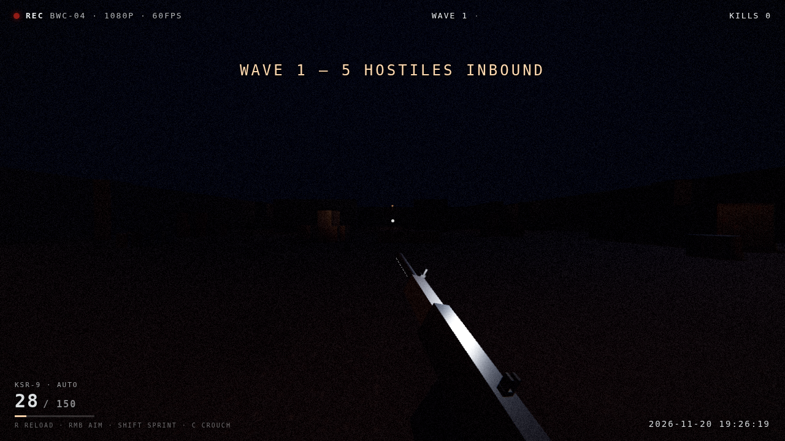

# LAST MAGAZINE — Bodycam Ops

A **bodycam-style first-person shooter** that runs entirely in the browser.
Built with **npm + Vite + TypeScript + three.js** — every texture, every sound
and every model is generated procedurally at runtime. **Zero binary assets.**

You are the camera. Hold Night Yard K-7 against escalating waves of hostiles,
with a weapon-mounted light cutting through the dark and a rig that bobs,
breathes, kicks and slumps the way a real body-mounted camera does.


---

## Running it

```bash
npm install
npm run dev        # → http://localhost:5173
```

Production build:

```bash
npm run build      # typechecks (tsc --noEmit) + bundles to dist/
npm run preview    # serves dist/
```

Desktop browser + mouse + sound required. Click to deploy (pointer lock),
Esc pauses, click to resume.

## Controls

| Input | Action |
| --- | --- |
| `WASD` | Move |
| Mouse | Look |
| `LMB` | Fire (full auto) |
| `RMB` | Aim down sights (FOV zoom, tight spread) |
| `R` | Reload (visual 3-stage mag swap) |
| `Shift` | Sprint (wider bob, faster strides) |
| `C` / `Ctrl` | Crouch |
| `Space` | Jump |
| `Esc` | Pause |

## What's inside

### The bodycam feel

- **Camera rig springs** — walk-cycle head bob with figure-eight motion,
  idle breathing, spring-damper viewpunch on every shot, trauma-based
  shake (quadratic falloff, layered sine "noise"), landing dips on jumps.
- **Weapon sway** — the viewmodel trails mouse input with exponential lag,
  bobs on a stride clock, breathes at idle, snaps through a sprint pose and
  a two-phase reload pose.
- **Post-processing grade** — fisheye barrel distortion, radial chromatic
  aberration, desaturated crushed-black color grade, vignette, animated
  film grain weighted toward shadows, and a red hurt vignette driven by
  damage and low health. 4x MSAA composer target.
- **Bodycam chrome** — blinking REC dot, camera ID, live timestamp, minimal
  crosshair, ammo block with reload bar, wave banners and kill feed.



### Gunplay

- Full-auto hitscan SMG (780 RPM) with a spread model: hip vs ADS bloom,
  movement and airborne penalties, per-shot bloom accumulation.
- Iron sights that are *constructed* to align at screen center in ADS.
- Zone damage on hostiles: head ×2.4, torso ×1.0, limbs ×0.6.
- Pooled effects: muzzle flash sprites + point lights, moving tracers,
  ballistic shell ejection with ground bounce and positional tink,
  sparks, bullet-hole decals and smoke puffs.
- The reload is fully animated: gun tilt, magazine slides out and drops as
  a physical prop, fresh mag seats, charging handle pulls — synced to five
  staged foley sounds.

### Sound — 100% synthesized, no audio files

Every buffer is rendered with raw sample math at boot:

- Layered gunshots (noise crack + band-shaped body + swept low thump) with
  generated convolution reverb for open-yard echo; separate distant variants
  for enemy fire.
- HRTF spatialised world audio with distance attenuation and a camera-synced
  listener (legacy API fallback included).
- Footsteps (4 variants), full reload foley, dry fire, bullet whiz-bys with
  pitch sweeps, impact grits, hurt grunt, low-health heartbeat, ambient wind
  loop and sparse world rumbles.

### Enemies & waves

- Box-built tactical hostiles: walk-cycled legs, vest, helmet, glowing
  visor, rifle with a world-space muzzle.
- AI: advance with stuck-detection detours, combat strafing, throttled
  line-of-sight raycasts, burst fire with distance/sprint/crouch accuracy,
  near-miss whiz-bys, flinches, physical death falls.
- Wave director: staggered spawns at cover-blocked points away from the
  player, 8-alive cap over a 16-slot pool, pairwise squad separation,
  escalating waves, health regen when out of combat.

### World

- 68m walled night yard: lane walls with doorways, stacked shipping
  containers, crate clusters, jersey barriers, barrels, colonnade.
- Procedural canvas textures (asphalt with cracks and oil stains, seamed
  concrete with drip stains, plank wood, corrugated rusted metal) on a
  deterministic seed, so the layout is identical every load.
- Sodium pole lamps, hemisphere fill, shadow-casting moonlight, exponential
  fog and a gradient sky dome.

## Architecture

```
src/
├── main.ts               orchestrator: renderer, game phases, frame loop
├── core/
│   ├── Input.ts          pointer-lock mouse look, consumable key presses
│   └── CameraRig.ts      bodycam rig: bob, breathing, viewpunch, shake, FOV
├── world/
│   └── MapBuilder.ts     procedural textures, geometry, lights, colliders
├── player/
│   └── Player.ts         accel/friction movement, AABB collision + step-up
├── weapons/
│   ├── Viewmodel.ts      gun mesh, sway/bob springs, reload keyframes
│   ├── Weapon.ts         fire control, hitscan, reload state machine
│   └── Fx.ts             pooled flashes, tracers, shells, impacts, debris
├── enemies/
│   ├── Enemy.ts          mesh, AI states, LOS, burst fire, death physics
│   └── EnemyManager.ts   wave director, spawning, pooling, separation
├── audio/
│   └── SFX.ts            procedural buffer synthesis + spatial playback
├── fx/
│   └── PostFX.ts         EffectComposer grade pass (lens + grain + hurt)
└── ui/
    └── Hud.ts            DOM overlay: bodycam chrome, banners, feedback
```

One deliberate seam: `Weapon` owns the shared `shootables` array (world +
enemy hit zones) and exposes its FX pools to the enemy manager, so both
sides reuse the same tracer/flash/impact pools and the same audio engine.

## Known simplifications

- The viewmodel renders in the same camera pass, so the gun can clip into
  walls when hugging them.
- Enemy navigation is steering-based (no navmesh) — they slide along cover
  and detour when stuck rather than pathfinding around it.
- Headless/software-rendered environments run below 60 FPS; the game caps
  dt at 50 ms so timing stays correct on slow machines.
