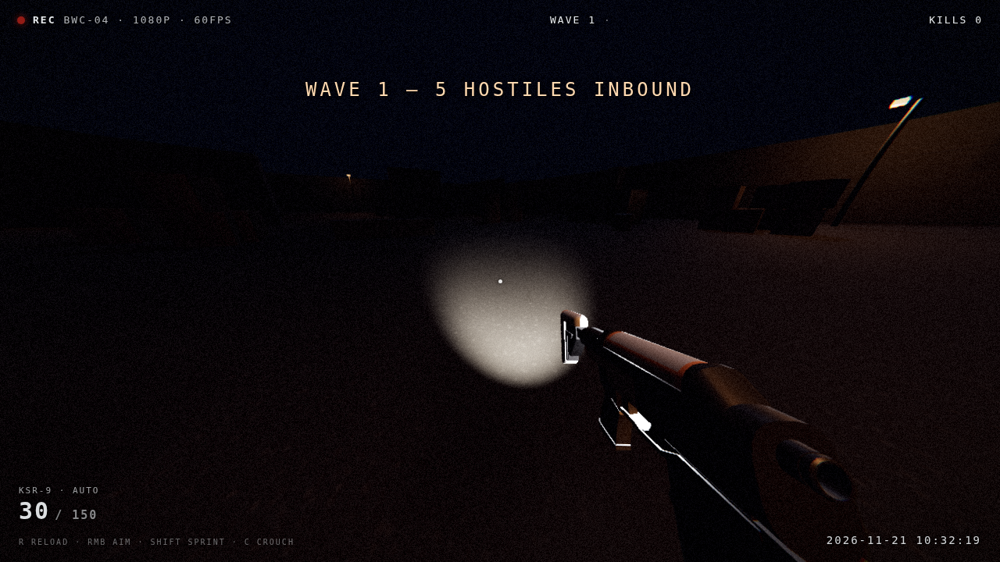
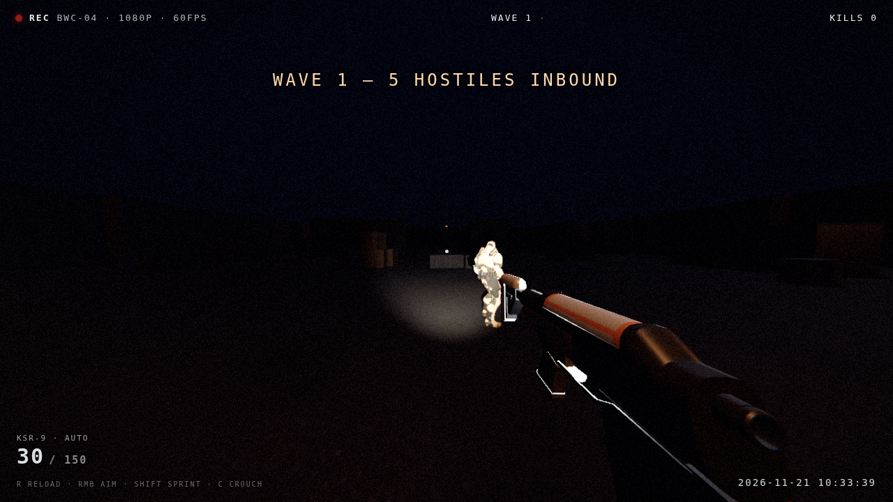

# LAST MAGAZINE — Bodycam Ops

A **bodycam-style first-person shooter** that runs entirely in the browser.
Built with **npm + Vite + TypeScript + three.js** — all textures, sounds and
effects are generated procedurally at runtime, on top of **real GLTF 3D
models** for the characters and weapons (see
[public/models/CREDITS.md](public/models/CREDITS.md)).

You are the camera. Night Yard K-7 is black — the burning barrels and your
weapon-mounted light are the only lights left. Hold it against escalating
waves of hostiles, with a rig that bobs, breathes, kicks and slumps the way
a real body-mounted camera does.



---

## Running it

```bash
npm install
npm run dev        # → http://localhost:5173
```

Production build:

```bash
npm run build      # typechecks (tsc --noEmit) + bundles to dist/
npm run preview    # serves dist/
```

Desktop browser + mouse + sound required. Click to deploy (pointer lock),
Esc pauses, click to resume.

## Controls

| Input | Action |
| --- | --- |
| `WASD` | Move |
| Mouse | Look |
| `LMB` | Fire (fast semi-auto) |
| `RMB` | Aim down sights (FOV zoom, tight spread) |
| `R` | Reload (hand-driven mag swap) |
| `F` | Toggle the weapon light |
| `Shift` | Sprint (wider bob, faster strides) |
| `C` / `Ctrl` | Crouch |
| `Space` | Jump |
| `Esc` | Pause |

## What's inside

### Real 3D models

- **Hostiles** are the rigged **Soldier** GLTF from the three.js example
  assets (Mixamo skeleton, `Idle` / `Walk` / `Run` clips), skeleton-cloned
  per hostile with a dedicated `AnimationMixer` — Run is time-scaled to
  match each soldier's movement speed. Height-normalized to 1.78 m from
  the bind-pose bbox.
- **The P9C viewmodel** is a Quaternius *Sci-Fi Modular Guns* pistol
  (CC0), normalized so the barrel points -z at a real-world 0.33 m
  length — recentered exactly, since the source model is not built
  around its own origin.
- **The hands are real skinned models too** — the WebXR `generic-hand`
  GLTFs (MIT), re-dressed as dark tactical gloves and seated by their
  `wrist` bone onto grip anchors measured from the pistol geometry.
  Every finger is posed through its joint bones: trigger finger straight
  on the trigger, the other three wrapped around the front strap, off
  hand cupping the frame from the left.
- **The reload is hand-driven**: the off hand dips off-screen, comes back
  carrying a fresh magazine (scaled SMG mag aligned to the grip rake),
  slaps it into the well while the spent mag drops as a ballistic prop,
  and the slide jolts home — synced to five staged foley sounds.
- **Enemy rifles** are the Quaternius AR model, slung across the chest
  with a world-space muzzle point for tracers and flash lights.
- Zone damage is delivered through invisible hitboxes (`colorWrite` /
  `depthWrite` off, still raycast-able) at head/torso/leg heights.
- Assets preload through a `LoadingManager` with a progress readout on
  the menu; deploy is gated until everything is loaded.



### The bodycam feel

- **Camera rig springs** — walk-cycle head bob with figure-eight motion,
  idle breathing, spring-damper viewpunch on every shot, trauma-based
  shake (quadratic falloff, layered sine "noise"), landing dips on jumps.
- **Weapon sway** — the viewmodel trails mouse input with exponential lag,
  bobs on a stride clock, breathes at idle, snaps through a sprint pose and
  a two-phase reload pose.
- **Post-processing grade** — fisheye barrel distortion, radial chromatic
  aberration, desaturated crushed-black color grade, deep vignette, animated
  film grain weighted toward shadows, digital dropout glitch rows (damage,
  random telecom dropouts, death) and a red hurt vignette. 4x MSAA composer
  target.
- **Bodycam chrome** — blinking REC dot, camera ID (30FPS label), battery
  readout that drains while recording, torch state, live timestamp, minimal
  crosshair, ammo block with reload bar, wave banners and kill feed.


### Gunplay

- Fast semi-auto hitscan pistol (≈400 RPM, 15+90 ammo) with a spread model:
  hip vs ADS bloom, movement and airborne penalties, per-shot bloom
  accumulation.
- Zone damage on hostiles: head ×2.4, torso ×1.0, limbs ×0.6.
- Pooled effects: muzzle flash sprites + point lights, moving tracers,
  ballistic shell ejection with ground bounce and positional tink,
  sparks, bullet-hole decals and smoke puffs.
- The weapon light (`F`) is a shadow-casting spotlight with beam lag that
  trails the eyes, battery-style micro flicker, and a short-range spill
  glow that keeps the gun and gloves visible — plus a start-of-run double
  beep and camera static.
- The reload is fully hand-driven: gun tilt, the off hand dips and seats
  the fresh mag, spent mag drops as a physical prop, slide jolt — synced
  to five staged foley sounds.

### Sound — 100% synthesized, no audio files

Every buffer is rendered with raw sample math at boot:

- Layered gunshots (noise crack + band-shaped body + swept low thump) with
  generated convolution reverb for open-yard echo; separate distant variants
  for enemy fire.
- HRTF spatialised world audio with distance attenuation and a camera-synced
  listener (legacy API fallback included).
- Footsteps (4 variants), full reload foley, dry fire, bullet whiz-bys with
  pitch sweeps, impact grits, hurt grunt, low-health heartbeat, ambient wind
  loop and sparse world rumbles.
- Bodycam chrome audio: start-of-recording double beep, gated static bursts
  on hits and death, torch click, and spatialised fire-crackle loops
  (stateful crackle synthesis) emitted from every burning barrel.

### Enemies & waves

- GLTF tactical soldiers (vest, helmet, visor) with blend-tree animations
  and a chest-slung AR rifle with a world-space muzzle.
- AI: advance with stuck-detection detours, combat strafing, throttled
  line-of-sight raycasts, burst fire with distance/sprint/crouch accuracy,
  near-miss whiz-bys, flinches, physical death falls.
- Wave director: staggered spawns at cover-blocked points away from the
  player, 8-alive cap over a 16-slot pool, pairwise squad separation,
  escalating waves, health regen when out of combat.

### World

- 68m walled night yard: lane walls with doorways, stacked shipping
  containers, crate clusters, jersey barriers, barrels, colonnade.
- Procedural canvas textures (asphalt with cracks and oil stains, seamed
  concrete with drip stains, plank wood, corrugated rusted metal) on a
  deterministic seed, so the layout is identical every load.
- **Flashlight-and-fire lighting only** — no ambient, hemisphere, moon or
  lamp lights exist in the scene. Six burning barrels (flickering point
  lights, additive flame quads, glowing coals) are the yard's only light
  sources; everything else is the player's weapon light. Exponential fog
  keeps the darkness thick while distant fires stay visible beacons, and
  a faint star dome replaces the old gradient sky.

## Architecture

```
src/
├── main.ts               orchestrator: renderer, asset boot, phases, frame loop
├── core/
│   ├── Input.ts          pointer-lock mouse look, consumable key presses
│   ├── CameraRig.ts      bodycam rig: bob, breathing, viewpunch, shake, FOV
│   └── Assets.ts         GLTF preload + gun/character normalization helpers
├── world/
│   ├── MapBuilder.ts     procedural textures, geometry, fires, colliders
│   └── Fire.ts           burning barrels: flame quads, coals, flicker light
├── player/
│   └── Player.ts         accel/friction movement, AABB collision + step-up
├── weapons/
│   ├── Viewmodel.ts      GLTF pistol + gloved hands, sway/bob springs, hand-driven reload
│   ├── Weapon.ts         fire control, hitscan, reload state machine
│   └── Fx.ts             pooled flashes, tracers, shells, impacts, debris
├── enemies/
│   ├── Enemy.ts          skinned soldier, mixer, AI states, LOS, death fall
│   └── EnemyManager.ts   wave director, spawning, pooling, separation
├── audio/
│   └── SFX.ts            procedural buffer synthesis + spatial playback
├── fx/
│   └── PostFX.ts         EffectComposer grade pass (lens + grain + hurt)
└── ui/
    └── Hud.ts            DOM overlay: bodycam chrome, banners, feedback
```

One deliberate seam: `Weapon` owns the shared `shootables` array (world +
enemy hit zones) and exposes its FX pools to the enemy manager, so both
sides reuse the same tracer/flash/impact pools and the same audio engine.

## Known simplifications

- The viewmodel renders in the same camera pass, so the gun can clip into
  walls when hugging them.
- Enemy navigation is steering-based (no navmesh) — they slide along cover
  and detour when stuck rather than pathfinding around it.
- The enemy rifle is chest-mounted rather than bone-attached to the hands,
  so it stays put while the Run clip swings the arms.
- Headless/software-rendered environments run below 60 FPS; the game caps
  dt at 50 ms so timing stays correct on slow machines.
